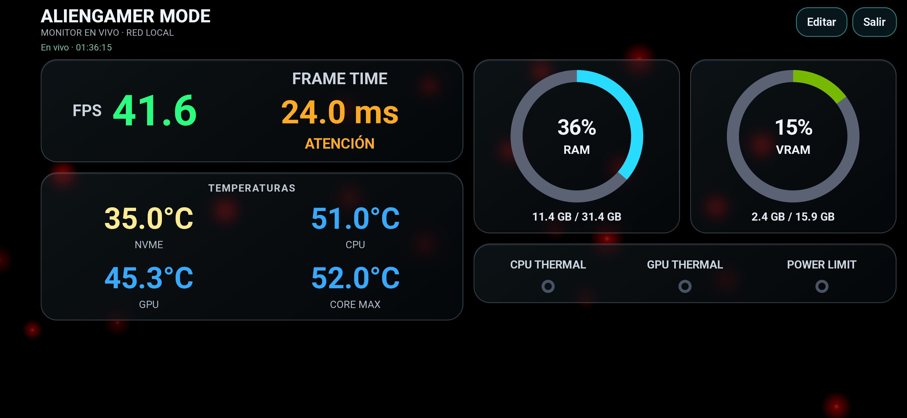
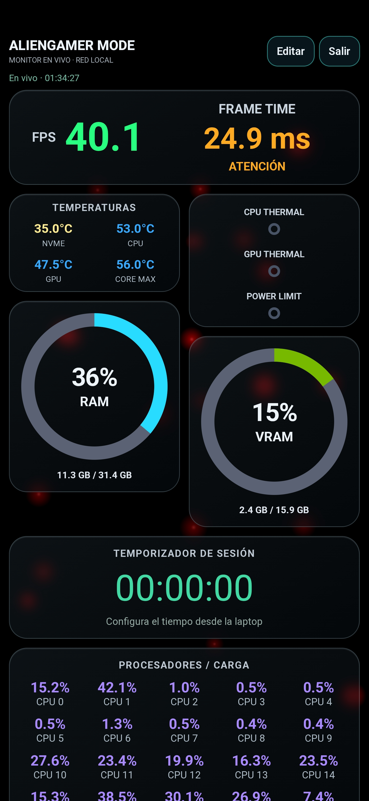
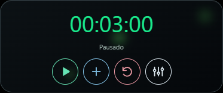

# AlienGamer Mode

[Español](README.md) · **English**

**Adaptive Windows hardware monitoring, with desktop, phone and tablet views.**

AlienGamer Mode combines Rainmeter and HWiNFO to display sensors, customize each screen and record performance events. It runs locally without telemetry and never presents missing sensors as real zero readings.

**Current version: 1.8.0** · [Download installer](https://github.com/alienmau/AlienGamer-Mode/releases/latest) · [Release notes](https://github.com/alienmau/AlienGamer-Mode/releases/latest)

[](https://github.com/alienmau/AlienGamer-Mode/releases/latest)
[](https://github.com/alienmau/AlienGamer-Mode/releases)
[](LICENSE)

## Screenshots

### Displays and layout

Dark theme, orange accents, display cards and sidebar options for organizing each view.


The editor screenshot uses test display data.

### Mobile dashboard

Translucent cards adapt to orientation and available space.



<p align="center">
  
  
</p>

Layout images are real Chrome screenshots shared from a phone. The timer screenshot uses test data.

## What you can do

### Monitor your hardware

- View RAM, VRAM, CPU/GPU usage and load per logical processor.
- Track CPU, maximum-core, GPU and primary-storage temperatures.
- Follow FPS and frame time with visual fluidity classifications.
- See thermal and power-limit flags when supplied by HWiNFO.
- Display a matrix-style clock and smoothly animated sensor rings.

Missing readings are hidden or shown as `N/A`. Availability depends on hardware and HWiNFO; sensors and fan speeds are not fabricated.

### Organize multiple displays

Open **Displays and layout...** from the tray:

- Enable several displays with independent modules, placement, sizes and backgrounds.
- Drag and resize blocks in a proportional display preview.
- Choose full, essential, portrait, performance-only or temperature-only presets.
- Adjust the selected display through **Modules**, **Background** and **Layout** panels.
- Preview and confirm with **Save and apply**, without restarting sensors or interrupting recording.

The editor prevents overlap and out-of-bounds placement, retains a fixed header and saves layouts across starts. Displays are recognized by physical identity.

Configuration uses dark grays, rounded buttons and orange accents. The tray provides start/stop, recording, incident markers, language, hardware configuration, logs and application exit.

### Use your phone or tablet as a display

Under **Displays and layout → Phone or tablet**, enable **Enable web monitor on my local network** and scan the QR. Both devices must use the same router; Ethernet on the PC and Wi-Fi on the phone work together.

- Responsive portrait/landscape views with masonry placement using each card's natural height.
- Individual RAM, VRAM, CPU-usage and GPU-usage rings; grouped temperatures.
- Combined FPS/frame-time module and separate alerts.
- **Edit** provides visibility, ordering and **Minimum** (one column unit), **Normal** (module base width) or **Extended** (full row) sizes.
- Preferences saved per device and retained on rotation.
- Glass cards, centered titles and decorative fireflies with selectable color.
- **Expand** and **Exit** affect only browser fullscreen, not the PC dashboard.

The optional service is off by default. It uses a private address, port 27844, a secret link and a firewall scoped to the local subnet. **New QR** revokes the previous link. No cloud or Internet port forwarding is required.

### HTTPS and keeping the screen awake

**Configure HTTPS** opens guided secure-connection setup. Once configured, **HTTPS active · View connection** opens the summary and QR.

Install the public certificate as a **CA, not Wi-Fi**, compare its fingerprint and verify **Connection is secure** in the browser. Do not bypass red certificate warnings. Installing a CA grants trust: verify it first and remove it when no longer needed.

**Edit → Keep screen awake** requests native browser wake lock on trusted HTTPS. Browser, OS, battery and permissions can limit support; manual locking remains possible. HTTP remains available as a read-only view, without this feature.

Restarting, toggling the service or rotating the QR does not require reinstalling the CA. Server-certificate renewal for changed IP or expiry retains the authority. A replacement authority, different PC/account or removed phone trust requires installation and verification again.

See the [mobile HTTPS guide](docs/MOBILE-HTTPS-GUIDE.md), including secure/insecure examples. Trusted HTTPS, screen-awake support and timer control were user-confirmed on Samsung S26 Ultra / One UI 9 / Chrome; physical tablet and iOS testing remains pending.

### One timer across all displays

PC and mobile show the same session: configure duration, start/pause, add up to three extra-time increments or reset.

- An unconfigured timer shows zeroes; reopening restores the saved duration ready to start.
- Smooth progress and color transitions: green below 70% elapsed, amber from 70% and red from 85%.
- **GAME OVER** remains fixed in red at completion, without zoom.
- Mobile icon controls have accessible names and 44px touch targets.
- Mobile control is off by default and requires **HTTPS plus explicit PC permission**. Otherwise it only displays the state.

Visibility is independent per display; the session and its changes are shared.

### Customize backgrounds

Each desktop display supports **Off**, **Custom** or **Thermal dynamic**. Custom mode exposes firefly count, speed, size and color. Thermal mode responds to valid temperatures/activity, smooths transitions and reduces movement under saturation or degraded frame time.

Mobile fireflies are decorative and independent of temperature. Desktop pixel shifting reduces prolonged static elements on OLED screens; it does not guarantee prevention of wear.

### Record and investigate events

**Record event** includes preceding context from a local 60-second buffer. Mark symptoms from the tray and finish recording to generate:

- A responsive HTML report that opens offline.
- An Excel workbook with samples, incidents, local comparison and a privacy sheet.
- A CSV for independent analysis.

Reports relate FPS, frame time, temperatures, memory, load and alerts, with a summary and stability score. They support correlation analysis, not independent proof of a failure's cause. Excel is optional; HTML and CSV are preserved whenever possible if unavailable.

## Requirements and installation

- 64-bit Windows 10/11 and at least a dual-core x64 processor.
- 4 GB RAM minimum; 8 GB recommended, or 16 GB when gaming on the same PC.
- Approximately 100 MB free storage, excluding reports.
- [Rainmeter 4.5 or later](https://www.rainmeter.net/).
- [HWiNFO 7.34 or later](https://www.hwinfo.com/download/) with sensors and Shared Memory Support.

Rainmeter and HWiNFO are external prerequisites, not bundled. Compatibility depends on exposed sensors; resource use varies with hardware, sensors, displays and effects.

1. Install prerequisites from their official sites and enable HWiNFO shared memory.
2. Download the installer from the [latest release](https://github.com/alienmau/AlienGamer-Mode/releases/latest).
3. Run setup and choose **English** or **Español**, display, GPU and primary storage.
4. Finish and customize views from the tray.

Full setup backs up and resets desktop visual and timer settings while preserving recordings, reports and existing mobile configuration. HTTPS identity is retained under the same account. This is not a silent update.

See [Prerequisites](docs/REQUISITOS-PREVIOS.md) and the [Installation guide](docs/GUIA-INSTALACION-MANUAL.md). Change language from the tray without restarting sensors.

## Languages and technologies

- **PowerShell:** agent, hardware discovery, configuration, sensor bridge, local web service and automation.
- **C# / .NET Framework / Windows Forms:** configuration components and console-free GUI executables.
- **HTML5, CSS and vanilla JavaScript:** mobile view, SVG rings and Canvas clock/fireflies. No React, Vue, Bootstrap or Node.js server required.
- **Lua and Rainmeter INI:** desktop views and animations.
- **VBScript:** launchers. **Inno Setup / Pascal Script:** installer.
- **Integrations:** Rainmeter, HWiNFO and QRCoder. The service uses PowerShell and .NET sockets for HTTP/HTTPS.
- **Development/testing only:** Node.js and Playwright.

GitHub calculates language percentages automatically; embedded CSS and JavaScript may count as HTML.

## Documentation and development

- [Mobile HTTPS guide](docs/MOBILE-HTTPS-GUIDE.md).
- [Display editor design](docs/DESKTOP-STUDIO.md).
- [Releases and detailed changes](https://github.com/alienmau/AlienGamer-Mode/releases).
- [Changelog](CHANGELOG.md) and [roadmap](docs/ROADMAP.md).
- [Report issues or compatibility](https://github.com/alienmau/AlienGamer-Mode/issues/new/choose).
- [Contributing](CONTRIBUTING.md).

This README describes the current product. Version-specific changes, fixes and validation belong in Releases and CHANGELOG, not an accumulating list on the main page.

Install Inno Setup 6, then validate and build:

```powershell
powershell.exe -NoProfile -ExecutionPolicy Bypass -File .\tests\Test-AlienGamerMode.ps1
powershell.exe -NoProfile -ExecutionPolicy Bypass -File .\installer\Build-Installer.ps1
```

The installer is generated under `build/installer/`.

## Privacy and license

No telemetry is sent. Reports can include process names and hardware details; review them before sharing. Do not publish secret QR links or private keys. Report vulnerabilities according to [SECURITY.md](SECURITY.md).

Original code uses the [MIT License](LICENSE); third parties retain their licenses and trademarks. The Dali font is not included; the author signature is distributed as an image.

Created by **Alienmau**.
