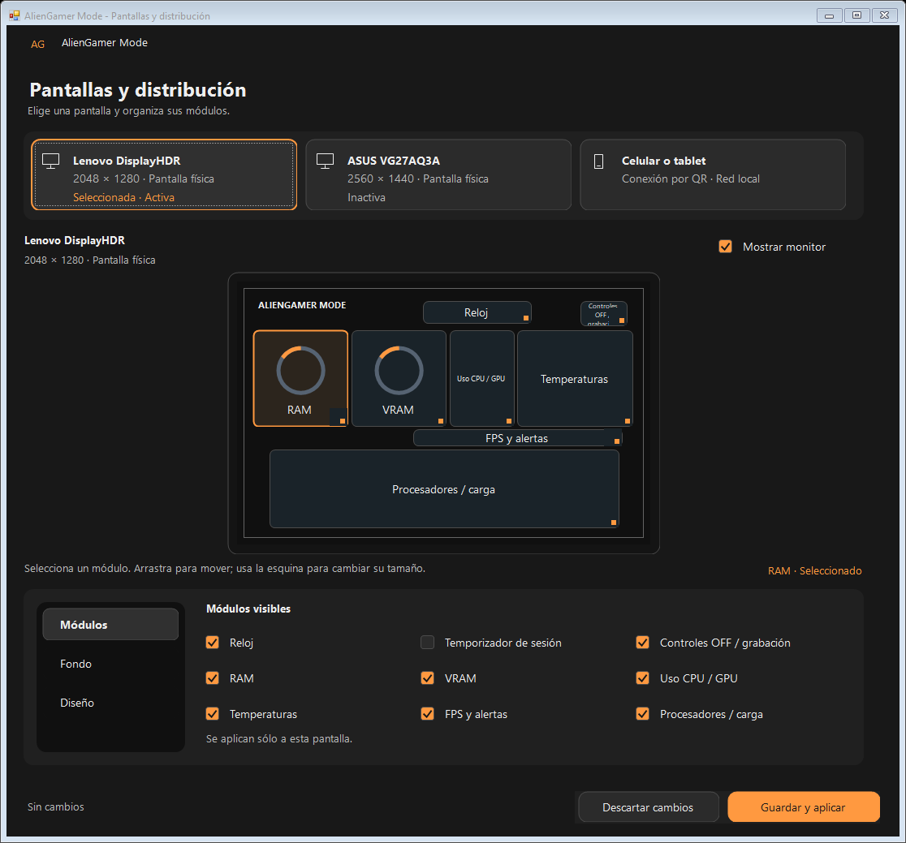
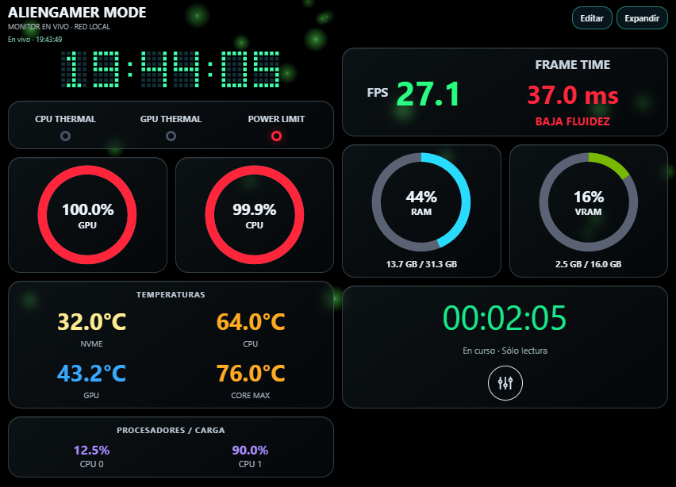
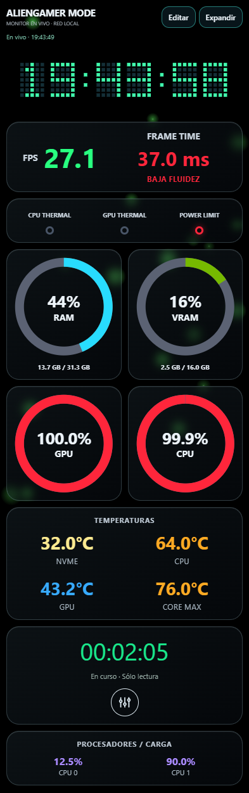
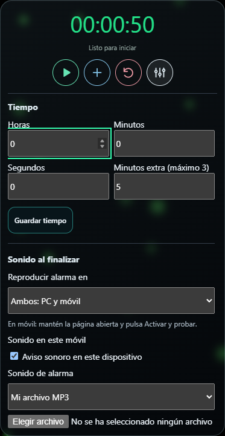
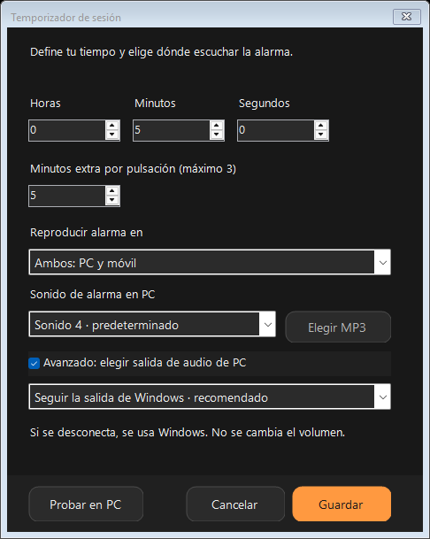

# AlienGamer Mode

**Español** · [English](README.en.md)

**Monitoreo adaptable del equipo para Windows, con vistas en monitores, celulares y tablets.**

AlienGamer Mode combina Rainmeter y HWiNFO para mostrar sensores, personalizar cada pantalla y registrar eventos de rendimiento. Trabaja localmente, sin telemetría, y no presenta sensores ausentes como valores reales de cero.

**Versión actual: 1.9.0** · [Descargar instalador](https://github.com/alienmau/AlienGamer-Mode/releases/latest) · [Notas de la versión](https://github.com/alienmau/AlienGamer-Mode/releases/latest)

[](https://github.com/alienmau/AlienGamer-Mode/releases/latest)
[](https://github.com/alienmau/AlienGamer-Mode/releases)
[](LICENSE)

## Tu celular o tablet, una pantalla para monitorear tu PC

¿Sólo tienes un monitor? Mantén el juego en tu pantalla principal y consulta temperaturas, uso de CPU/GPU, RAM, VRAM y los datos de FPS disponibles en tu smartphone o tablet, en tiempo real y sin salir del juego. **No necesitas un segundo monitor ni una vista de escritorio activa.** La PC por Ethernet y el móvil por Wi-Fi pueden compartir el mismo router.

Personaliza las tarjetas, gira el dispositivo y usa pantalla completa. Con **HTTPS local confiable**, el certificado generado en tu propia PC y un navegador compatible puedes activar **Mantener pantalla encendida**. El asistente explica cómo verificar e instalar la CA; no se deben ignorar avisos de seguridad.

**Controla tu tiempo para jugar o trabajar:** utiliza el temporizador para recordar levantarte, estirarte o alejarte un rato de la PC. **Elige tu sonido de alarma** entre cuatro efectos o tu propio MP3, y decide si sonará en **Sólo móvil, Sólo PC o Ambos**. Sonido 4 es el predeterminado; en móvil hay que permitir el audio y mantener la página abierta.

## Así se ve

### Pantallas y distribución

Tema oscuro, acento naranja, tarjetas de pantallas y opciones laterales para organizar cada vista.



El editor mostrado utiliza datos de pantallas de prueba.

### Monitor móvil

¿Sólo tienes un monitor? Juega en tu pantalla principal y consulta el estado de tu PC en tiempo real desde un smartphone o tablet conectado a la misma red local, sin salir del juego ni necesitar otro monitor.

Tarjetas translúcidas que se adaptan a la orientación y al espacio disponible.



<p align="center">
  
  
</p>

Capturas de las interfaces implementadas con datos de prueba, no maquetas ni sensores reales del equipo del usuario. No contienen QR privados ni claves.

## Qué puedes hacer

### Supervisar el equipo

- Ver RAM y VRAM, carga de CPU/GPU y carga por procesador lógico.
- Consultar temperaturas de CPU, núcleo máximo, GPU y almacenamiento principal.
- Seguir FPS y tiempo de cuadro con clasificación visual de fluidez.
- Ver alertas térmicas y de límite de potencia cuando HWiNFO las proporciona.
- Mostrar un reloj digital tipo matriz y anillos con animaciones suavizadas.

Las lecturas ausentes se ocultan o aparecen como `N/D`. La disponibilidad depende del hardware y de HWiNFO; no se inventan sensores ni velocidades de ventiladores.

### Organizar varias pantallas

Abre **Pantallas y distribución...** desde el icono de bandeja:

- Activa varias pantallas con módulos, posición, tamaño y fondo independientes.
- Arrastra y redimensiona bloques en una vista previa proporcional al monitor.
- Elige diseños completos, esenciales, verticales, de rendimiento o de temperaturas.
- Ajusta la pantalla seleccionada desde los paneles **Módulos**, **Fondo** y **Diseño**.
- Previsualiza y confirma con **Guardar y aplicar**, sin reiniciar sensores ni interrumpir la grabación.

El editor evita solapamientos y salidas del lienzo, conserva el encabezado fijo y guarda la distribución para los siguientes arranques. Las pantallas se reconocen por su identidad física.

La configuración usa grises oscuros, botones redondeados y acento naranja. El menú de bandeja permite iniciar/detener, grabar, marcar incidentes, cambiar idioma, configurar hardware, consultar registros y cerrar la aplicación.

**Configurar hardware** administra GPU y almacenamiento. Pantallas y móvil se organizan en **Pantallas y distribución**; **Herramientas → Editar archivo de configuración** es una opción avanzada con aviso y respaldo, no necesaria para el uso habitual.

### Usar el monitor desde un celular o tablet

En **Pantallas y distribución → Celular o tablet**, activa **Activar monitor web en mi red local** y escanea el QR. Ambos equipos deben usar el mismo router; Ethernet en la PC y Wi-Fi en el móvil funcionan juntos.

- Vista responsive vertical/horizontal, con organización masonry que aprovecha la altura natural de las tarjetas.
- Anillos individuales de RAM, VRAM, uso CPU y uso GPU; temperaturas agrupadas.
- FPS y tiempo de cuadro unidos, con alertas en un módulo independiente.
- **Editar** permite mostrar/ocultar, reordenar y elegir **Mínimo** (una unidad de columna), **Normal** (ancho base del módulo) o **Extendido** (fila completa).
- Preferencias guardadas en cada dispositivo y conservadas al girar.
- Tarjetas de vidrio, títulos centrados y luciérnagas decorativas con color configurable.
- **Expandir** y **Salir** controlan sólo la pantalla completa del navegador, no el monitor de la PC.
- Puedes usar **sólo celular/tablet** sin activar pantallas físicas; en ese modo Rainmeter es opcional.

El servicio es opcional y está desactivado por defecto. Usa una dirección privada y el puerto 27844, un enlace secreto y firewall limitado a la subred local. **Nuevo QR** revoca el enlace anterior. No requiere nube ni abrir puertos a Internet.

### HTTPS y pantalla encendida

**Configurar HTTPS** abre el asistente de conexión segura. Una vez configurada, **HTTPS activo · Ver conexión** muestra el resumen y el QR.

Instala el certificado público como **CA, no Wi-Fi**, compara su huella y comprueba que el navegador indique **La conexión es segura**. No ignores advertencias rojas ni uses «continuar de todos modos». Instalar una CA otorga confianza: verifícala antes y elimínala cuando ya no la necesites.

**Editar → Mantener pantalla encendida** solicita el permiso nativo en HTTPS confiable. Depende del navegador, sistema, batería y permisos; permite bloquear manualmente. HTTP sigue disponible como vista de sólo lectura, sin esta función.

Reiniciar, desactivar/reactivar o renovar el QR no exige reinstalar la CA. La renovación del certificado servidor por IP o vencimiento conserva la misma autoridad. Una autoridad nueva, otro equipo/cuenta o eliminar el certificado del móvil sí requieren instalarlo y verificarlo nuevamente.

Consulta la [guía paso a paso de HTTPS móvil](docs/MOBILE-HTTPS-GUIDE.md), con ejemplos de conexión segura e insegura. HTTPS, pantalla encendida y control del temporizador fueron confirmados por el usuario en Samsung S26 Ultra / One UI 9 / Chrome; tablets e iOS físicos siguen pendientes.

### Temporizador único en todas las pantallas

PC y móvil muestran la misma sesión: configura la duración, inicia/pausa, añade hasta tres incrementos de minutos extra o restablece.

Organiza tu tiempo para jugar o trabajar y utiliza el temporizador como recordatorio para levantarte, estirarte o alejarte un rato de la PC.

- Sin configuración muestra ceros; al volver a abrir el monitor recupera la duración guardada lista para iniciar.
- Progreso suavizado y transición de colores: verde antes del 70% consumido, ámbar desde 70% y rojo desde 85%.
- Al terminar, **GAME OVER** queda fijo en rojo, sin zoom.
- Controles móviles por iconos con nombres accesibles y áreas táctiles de 44 px.
- Control móvil desactivado por defecto: requiere **HTTPS y autorización explícita en la PC**. Sin permiso, sólo muestra el estado.
- El mismo icono **Configurar** reúne tiempo y sonido. Hay cuatro efectos (Sonido 4 predeterminado) o MP3 propio de hasta 10 MB. **Probar** cambia a **Detener**; guardar o cerrar ajustes detiene la prueba.
- Destino compartido de alarma: **Sólo móvil** (predeterminado), **Sólo PC** o **Ambos**. La PC puede sonar incluso con únicamente la vista móvil activa.
- PC sigue la salida que Windows tenga seleccionada al comenzar la alarma. En **Avanzado** puedes fijar un dispositivo; si está desconectado, se usa Windows y se avisa. No cambia volumen ni silencio.
- El MP3 del celular se guarda sólo en ese navegador. Sonido local sigue disponible en modo sólo lectura, pero cambiar tiempo/destino compartido requiere permiso. Audio móvil depende de permiso, volumen y página abierta; no sustituye una alarma del sistema.

La visibilidad es independiente por pantalla; la sesión y sus cambios son compartidos.

[Guía de alarmas PC/móvil y MP3 propios](docs/MOBILE-TIMER-AUDIO.md).



### Personalizar el fondo

Cada monitor puede usar **Desactivado**, **Personalizado** o **Dinámico térmico**. El personalizado permite elegir cantidad, velocidad, tamaño y color de luciérnagas con una barra arcoíris, vista previa y brillo, sin introducir RGB. El térmico responde a temperaturas/actividad válidas, suaviza transiciones y reduce movimiento ante saturación o peor tiempo de cuadro.

Las luciérnagas móviles son decorativas, independientes de la temperatura. El escritorio también usa pequeños desplazamientos periódicos para reducir elementos estáticos prolongados en OLED; no garantiza evitar desgaste.

### Registrar e investigar eventos

**Grabar evento** conserva contexto previo con un búfer local de 60 segundos. Marca los momentos del problema desde la bandeja y termina la grabación para generar:

- Un reporte HTML responsive que se abre sin Internet.
- Un libro Excel con muestras, incidentes, comparación local y hoja de privacidad.
- Un CSV para análisis independiente.

Los reportes relacionan FPS, tiempo de cuadro, temperaturas, memoria, carga y alertas, con resumen y puntuación de estabilidad. Ayudan a investigar correlaciones, no demuestran por sí solos la causa de un fallo. Excel es opcional; HTML y CSV se conservan cuando es posible si no está disponible.

## Requisitos e instalación

- Windows 10/11 de 64 bits y procesador x64 de dos núcleos como mínimo.
- 4 GB de RAM mínimo; 8 GB recomendados, o 16 GB si se juega en el mismo equipo.
- Aproximadamente 100 MB libres, sin contar reportes.
- [Rainmeter 4.5 o posterior](https://www.rainmeter.net/) para vistas de escritorio; opcional en modo sólo móvil.
- [HWiNFO 7.34 o posterior](https://www.hwinfo.com/download/), con sensores y memoria compartida habilitados.

Rainmeter y HWiNFO se obtienen por separado; HWiNFO se necesita para sensores, Rainmeter sólo para vistas de escritorio. La compatibilidad depende de los sensores del equipo; el consumo varía con hardware, sensores, pantallas y efectos.

1. Instala los requisitos desde sus sitios oficiales y habilita la memoria compartida de HWiNFO.
2. Descarga el instalador de la [última versión](https://github.com/alienmau/AlienGamer-Mode/releases/latest).
3. Ejecuta y elige **Español** o **English**, destino **Pantallas del equipo**, **Sólo celular/tablet** o **Ambos**, GPU y almacenamiento principal. Sólo móvil no exige elegir un monitor físico y abre el acceso por QR al finalizar.
4. Finaliza y personaliza las vistas desde el icono de bandeja.

La instalación completa respalda y reinicia ajustes visuales de escritorio y temporizadores; conserva grabaciones, reportes y configuración móvil existente. La identidad HTTPS se conserva en la misma cuenta. No es una actualización silenciosa.

Consulta [Requisitos previos](docs/REQUISITOS-PREVIOS.md) y la [Guía de instalación](docs/GUIA-INSTALACION-MANUAL.md). Puedes cambiar el idioma desde la bandeja sin reiniciar los sensores.

## Lenguajes y tecnologías

- **PowerShell:** agente, detección de hardware, configuración, puente de sensores, servicio web local y automatización.
- **C# / .NET Framework / Windows Forms:** configuración y ejecutables gráficos sin consola.
- **HTML5, CSS y JavaScript sin framework:** vista móvil, anillos SVG y Canvas para reloj/luciérnagas. No requiere React, Vue, Bootstrap ni servidor Node.js.
- **Lua e INI de Rainmeter:** vistas y animaciones de escritorio.
- **VBScript:** lanzadores. **Inno Setup / Pascal Script:** instalador.
- **Integraciones:** Rainmeter, HWiNFO y QRCoder. El servicio usa PowerShell y sockets .NET para HTTP/HTTPS.
- **Sólo desarrollo/pruebas:** Node.js y Playwright.

GitHub calcula sus porcentajes automáticamente; CSS y JavaScript integrados pueden contabilizarse como HTML.

## Documentación y desarrollo

- [Guía de HTTPS móvil](docs/MOBILE-HTTPS-GUIDE.md).
- [Diseño del editor](docs/DESKTOP-STUDIO.md).
- [Versiones y cambios detallados](https://github.com/alienmau/AlienGamer-Mode/releases).
- [Historial de cambios](CHANGELOG.md) y [próximas mejoras](docs/ROADMAP.md).
- [Reportar un problema o compatibilidad](https://github.com/alienmau/AlienGamer-Mode/issues/new/choose).
- [Contribuir](CONTRIBUTING.md).

Este README describe el producto actual. Los cambios por versión, fixes y validaciones se documentan en Releases y CHANGELOG, no como una lista acumulada en la página principal.

Para validar y compilar, instala Inno Setup 6 y ejecuta:

```powershell
powershell.exe -NoProfile -ExecutionPolicy Bypass -File .\tests\Test-AlienGamerMode.ps1
powershell.exe -NoProfile -ExecutionPolicy Bypass -File .\installer\Build-Installer.ps1
```

El instalador se genera en `build/installer/`.

## Privacidad y licencia

No se envía telemetría. Los reportes pueden incluir nombres de procesos y hardware: revísalos antes de compartirlos. No publiques enlaces secretos del QR ni claves privadas. Reporta vulnerabilidades siguiendo [SECURITY.md](SECURITY.md).

Código propio bajo [licencia MIT](LICENSE); terceros conservan sus licencias y marcas. La fuente Dali no se incluye; la firma del autor se distribuye como imagen.

Creado por **Alienmau**.
