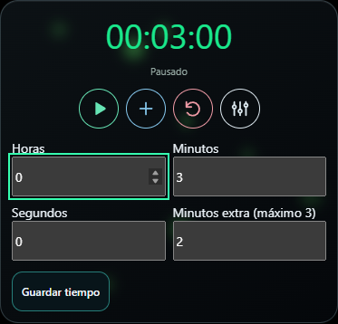

# Mejoras verificadas / Verified improvements — 2026-10-10

Estas mejoras forman parte de **1.8.0**. [Instalador y notas de la versión](https://github.com/alienmau/AlienGamer-Mode/releases/tag/v1.8.0). La versión anterior 1.7.0 no incluye HTTPS ni el control móvil del temporizador.

These changes are included in **1.8.0**. [Installer and release notes](https://github.com/alienmau/AlienGamer-Mode/releases/tag/v1.8.0). The previous 1.7.0 installer does not include HTTPS or mobile timer controls.

## Español

- Interfaz oscura con acento naranja: tarjetas de pantallas, vista previa y navegación lateral Módulos/Fondo/Diseño. Disponible desde 1.7.0; se mantienen preferencias independientes por pantalla.
- Corregido el acceso antiguo que dejaba una consola PowerShell abierta. El usuario confirmó el inicio sin esa ventana.
- HTTPS local opcional: asistente guiado, certificado propio por instalación, comparación de huella y conexión cifrada dentro de la LAN. Se conserva HTTP como alternativa de sólo lectura.
- «HTTPS activo · Ver conexión» sustituye el botón de configuración cuando ya está preparado, evitando repetir el asistente.
- Corregidos errores del asistente anidado, conservación de preferencias móviles al guardar y problemas del QR/servicio provocados por rutas y contexto de ejecución distintos.
- Temporizador único: configurar, iniciar, pausar, añadir minutos o restablecer modifica la sesión que leen todas las pantallas. El control móvil es opcional, se habilita en la PC y requiere HTTPS. Sin permiso, sólo lectura.
- Verde hasta 70% consumido; ámbar desde 70%; rojo desde 85% y GAME OVER fijo al terminar. Transición de color de 0,3 s.
- Controles móviles planos SVG, botones táctiles de 44 px y nombres accesibles. Sin título ni leyendas repetitivas de sincronización; se conservan errores y confirmaciones.
- Corregido «Conectando…» sin módulos: los botones se enlazan después de añadir las tarjetas al documento.
- Vista móvil adaptable: tamaños Mínimo/Normal/Extendido, organización masonry, reordenación, visibilidad, tarjetas translúcidas y color decorativo de luciérnagas. FPS y tiempo de cuadro juntos; alertas separadas. Estas opciones visuales ya forman parte de 1.7.0.

## English

- Unified dark/orange desktop UI with display cards, preview and vertical Modules/Background/Layout navigation, already available in 1.7.0.
- Fixed legacy shortcuts leaving an empty PowerShell window open; confirmed by the user.
- Optional LAN HTTPS: guided setup, installation-specific certificate, fingerprint verification and encrypted transport. HTTP remains a read-only alternative.
- Already-configured HTTPS opens a connection summary instead of restarting setup.
- Fixed nested setup dialog errors, mobile preference preservation, and QR/service failures caused by inconsistent paths and process context.
- One shared timer across screens, with optional mobile configure/start/pause/extra/reset controls. Explicit PC permission and HTTPS are required; read-only is the default.
- Matching desktop/mobile timer colors: green below 70% elapsed, amber from 70%, red from 85%, fixed red GAME OVER; 0.3-second color transitions.
- Flat local SVG timer controls, accessible names and 44px touch targets. Removed repetitive headings/success notices while retaining errors and confirmations.
- Fixed mobile startup stuck on “Connecting…” because timer handlers referenced detached controls.
- Responsive masonry cards, Minimum/Normal/Extended sizes, ordering, visibility, translucent surfaces and selectable decorative fireflies are already part of 1.7.0. FPS/frame time share a card; alerts remain separate.

## Capturas / Screenshots

Capturas de pruebas con valores simulados, sin QR, direcciones privadas ni datos del usuario. / Test captures with simulated values, no QR codes, private addresses or user data.

## HTTPS, instrucciones y límites / HTTPS instructions and limitations

[Guía bilingüe de conexión segura](MOBILE-HTTPS-GUIDE.md).

El usuario confirmó HTTPS confiable, pantalla encendida y temporizador móvil en Samsung S26 Ultra / One UI 9 / Chrome. Pruebas de navegador: ocho tamaños de pantalla, orientación, edición y permisos. Pruebas del servicio: HTTPS, rechazo de control sin permiso/origen ajeno, conflictos, migración y escrituras simultáneas. No implica compatibilidad física universal ni validación en iOS/tablets reales.

User-confirmed trusted HTTPS, screen-awake support and mobile timer operation on Samsung S26 Ultra / One UI 9 / Chrome. Browser and service regression tests passed; this is not a claim of universal physical-device compatibility. Fan RPM visualization remains planned, not implemented.
